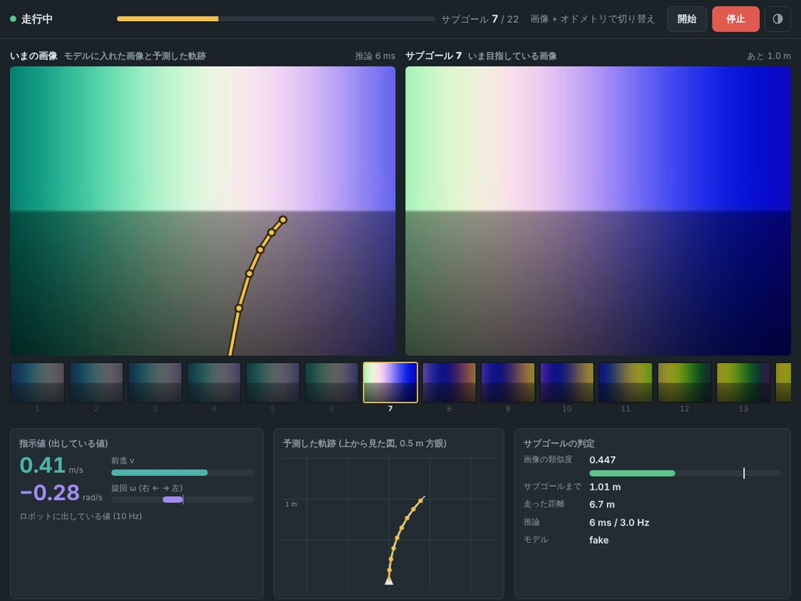

# Jetson AGX Orin での手順 (ROS 1)

[README](../README.md) の 8 です。学習・topomap・机上評価 (1〜7) は [training_pc.md](training_pc.md) にあります。

## コマンド (`bin/`)

| コマンド | どこで | 中でしていること |
|---|---|---|
| `bin/to_jetson.sh user@jetson [--bag BAG] [--configs]` | 学習 PC | 重み・topomap (・評価用の bag・設定) を rsync で送る |
| `bin/jetson.sh build\|up [--standalone]\|restart\|status\|logs\|plot\|down` | Jetson | `docker-compose.jetson.yml` (推論サーバ + ROS 1 ノード) |
| `bin/jetson.sh shell [--standalone] [コマンド]` | Jetson | ROS 1 のコンテナで `rostopic list` / `hz` など |
| `bin/desk_eval.sh` / `replay.sh` / `replay_video.sh` / `plot_nav_log.sh` など | Jetson | 学習 PC と同じ確認 ([1-3](#1-3-机上評価bag-で確認する)) |

- 使い方は `-h` で表示します。`OMNIVLA_DRY_RUN=1` を付けると、実行せずに中のコマンドを表示します。

## 構成

コンテナを 2 つに分け、localhost の HTTP でつなぎます。

| コンテナ | 中身 | Dockerfile |
|---|---|---|
| `policy` | 推論サーバ (Python)。OmniVLA を GPU で動かす。ROS なし | `docker/Dockerfile.jetson` |
| `nav` | ROS 1 Noetic のナビゲーションノード (C++) とデバッグ画面。PyTorch なし | `docker/Dockerfile.ros1` |

分けている理由: ROS 1 Noetic は Ubuntu 20.04 用ですが、Jetson で GPU を使える PyTorch は JetPack ごとに Ubuntu が決まっています (JetPack 6 は 22.04)。分けておけば、JetPack が決まっていなくても ROS 1 側はそのまま使えます。

推論サーバのベースイメージは、JetPack に合わせて `.env.jetson` の `JETSON_BASE_IMAGE` で選びます。

| JetPack | `JETSON_BASE_IMAGE` |
|---|---|
| 6.1 / 6.2.x (L4T R36.4.x。今回の Orin は R36.4.7) | `dustynv/l4t-pytorch:r36.4.0` (既定) |
| 6.0 (L4T r36.2) | `dustynv/l4t-pytorch:r36.2.0` |
| 5.1.2 (L4T r35.4) | `dustynv/l4t-pytorch:2.2-r35.4.1` |


## 全体の流れ

| | すること | ROS master |
|---|---|---|
| [1. Orin 単体のセットアップ](#1-orin-単体のセットアップ) | イメージを作る → 学習 PC から重み・topomap・bag を送る → 机上評価・bag で確認 → 単体でノードを起動 | Orin (`--standalone`) |
| [2. ATMOBI PC との接続](#2-atmobi-pc-との接続) | IP → 時刻合わせ → ROS の通信確認 → 低速で走行 | ATMOBI PC |

| | IP | 役割 |
|---|---|---|
| ATMOBI PC | `192.168.0.100/24` | roscore (ROS master)、カメラ・オドメトリ、`/cmd_vel` を受けて動かす、時刻の基準 |
| Orin | `192.168.0.200/24` (ゲートウェイなし) | 推論サーバ + ナビゲーションノード (docker、`network_mode: host`) |

使うのは `192.168.0.x` の 2 台だけのネットワークです。社内 LAN とはつなぎません。

## 1. Orin 単体のセットアップ

ATMOBI PC につながなくてもできる部分です。ROS master (roscore) は Orin の中で立てます。

### 1-1. Orin の準備

JetPack 6 (L4T r36.x) と docker、NVIDIA Container Runtime が入っていることが前提です (JetPack の標準構成で入っています)。外部のネットワークにつながる状態で行います。

```bash
cat /etc/nv_tegra_release          # JetPack (L4T) のバージョン → 上の表で JETSON_BASE_IMAGE を決める
sudo nvpmodel -m 0 && sudo jetson_clocks   # 最大性能 (推論時間に効く)
df -h /                            # イメージは 7B 込みで数十 GB. 空きを確認

git clone https://github.com/mamoru1126/omnivla_real.git && cd omnivla_real
bin/setup.sh none                  # Jetson 用のイメージ (推論サーバ・ROS 1) をビルド. 重みは学習 PC から送る
```

Orin では `.env` ではなく、リポジトリに入っている **`.env.jetson`** を使います (`bin/*.sh` が自動で切り替えます。Orin に `.env` があっても使いません)。本番の値が入っています。

| 項目 | 値 |
|---|---|
| `JETSON_BASE_IMAGE` / `WITH_7B` | `dustynv/l4t-pytorch:r36.4.0` / `1` (7B の依存を入れる) |
| `NAV_MODEL` / `FINETUNED_DIR` | `7b` / 学習 PC の `bin/to_jetson.sh` が最後に表示する値 |
| `NAV_AUTOSTART` | `false` (ブラウザの「開始」で走り出す) |
| `ROS_MASTER_URI` / `ROS_IP` | `http://192.168.0.100:11311` / `192.168.0.200` (単体のときは `--standalone` で localhost になる) |

- `docker compose` を直接打つときは `--env-file .env.jetson` を付けます。
- 7B は bf16 で約 15 GB のメモリ (Orin は CPU と GPU で共有) を使います。

### 1-2. 学習 PC で学習して、Orin に送る

学習・topomap・机上評価は学習 PC で行います ([training_pc.md](training_pc.md) の 1〜6)。学習 PC の `.env` に `NAV_MODEL` / `FINETUNED_DIR` / `TOPOMAP` を書いてから:

```bash
# 学習 PC で
bin/to_jetson.sh user@<Orin の IP> --bag 20260919_150554.bag --configs
```

- 重み (7B は元のモデルも)、topomap、評価用の bag、`configs/robot.yaml` / `navigator.yaml` が送られます。rsync なので 2 回目からは変わった分だけです。
- 最後に表示される `NAV_MODEL=...` などの行が Orin の `.env.jetson` と違っていれば、合わせます。
- 学習 PC から Orin に ssh できるネットワークで行います (ATMOBI PC との 2 台のネットワークとは別。Orin を一時的に社内のネットワークにつなぐなど)。

### 1-3. 机上評価・bag で確認する

学習 PC と同じコマンドが Orin でも動きます。モデルは走行と同じ推論サーバを使うので、**Orin での推論時間**も分かります。

```bash
bin/desk_eval.sh 20260919_150554.bag course_a      # report.txt の「推論時間」と、学習 PC の結果との差を見る
bin/replay.sh 20260919_150554.bag course_a         # bag をロボットの代わりに流して、ブラウザ (http://<Orin の IP>:8080) で確認
bin/replay.sh down                                 # 片付け
```

- 推論時間の中央値が waypoint の間隔 (約 333 ms) より大きく遅い場合は、`.env.jetson` で edge にします (`NAV_MODEL=edge`、`NAV_HALF=1` で半精度)。
- ADE やサブゴールのずれが学習 PC の結果とほぼ同じなら、Orin でも同じように動いています。

| コマンド | 学習 PC | Orin |
|---|---|---|
| `bin/desk_eval.sh` | 学習用コンテナでモデルを直接読み込む | 推論サーバを起動して使う (`--model remote`)。動いていればそのまま |
| `bin/replay.sh` / `replay_video.sh` | 推論サーバは `docker-compose.yml` の `policy` | 推論サーバは `docker-compose.jetson.yml` の `policy` |
| `bin/bag_info.sh` / `check_odometry.sh` / `make_topomap.sh` / `plot_nav_log.sh` / `shell.sh` | 学習用コンテナ | 推論サーバのイメージ |
| `bin/train.sh` / `make_dataset.sh` | ○ | 学習 PC で |

- Jetson かどうかは `/etc/nv_tegra_release` で見分けます (`OMNIVLA_JETSON=1` / `0` で決め打ちも可)。
- bag を読むもの (rosbags) は Python 3.10 以上が要るので JetPack 6 だけです。

### 1-4. 単体でノードを起動する

```bash
bin/jetson.sh up --standalone       # roscore + 推論サーバ + ナビゲーションノード. ログを表示 (Ctrl-C で表示だけ止まる)
bin/jetson.sh status                # コンテナの状態と推論サーバの応答
bin/jetson.sh shell --standalone rostopic list   # /omnivla/status などが見える
bin/jetson.sh down
```

- `--standalone` のときは `.env.jetson` の `ROS_MASTER_URI` / `ROS_IP` を使わず、`localhost` で動きます (2 の設定を書いたままでよい)。
- ブラウザ (http://&lt;Orin の IP&gt;:8080) でデバッグ画面が開けば OK です。カメラ画像が来ていないので「画像待ち」のままになります。
- Orin にカメラを直接つないで試す場合は、カメラのドライバも同じ master (`http://localhost:11311`) につなぎます。

## 2. ATMOBI PC との接続

### 2-1. IP

**Orin** (NetworkManager。インターフェース名は `ip link` で確認。例は `eth0`):

```bash
sudo nmcli con add type ethernet ifname eth0 con-name robot-lan \
  ipv4.method manual ipv4.addresses 192.168.0.200/24 ipv4.never-default yes ipv6.method ignore
sudo nmcli con up robot-lan
ping -c 3 192.168.0.100
```

- ゲートウェイは設定しません (`ipv4.never-default yes`)。2 台の間の通信には不要で、設定すると外部への通信がこちらに流れてしまいます。
- **ATMOBI PC** は `192.168.0.100/24` (同じくこのネットワークにはゲートウェイなし)。
- ROS 1 は使うポートが毎回変わるので、ファイアウォール (ufw など) を使っている場合は `192.168.0.0/24` からの通信を許可します。

### 2-2. 時刻合わせ (Orin を ATMOBI PC に合わせる)

画像の時刻が 2 台でずれていると、Orin は「画像が古い」と判断して止まり続けます (`navigator.yaml` の `max_image_age` 0.5 秒)。chrony で ATMOBI PC の時刻に合わせます。

**ATMOBI PC** (時刻の基準になる):

```bash
sudo apt install chrony
# Orin からの問い合わせを許可し、外部の時刻サーバに届かなくても自分の時刻を配る
printf 'allow 192.168.0.0/24\nlocal stratum 10\n' | sudo tee -a /etc/chrony/chrony.conf
sudo systemctl restart chrony
```

**Orin**:

```bash
sudo apt install chrony          # systemd-timesyncd の代わりに入る (外部ネットワークにつながる間に入れておく)
# 既存の時刻サーバ (pool / server 行) を止めて、ATMOBI PC だけを見る.
# makestep 1 -1: ずれが 1 秒以上なら、起動直後に限らずいつでも一気に合わせる
sudo sed -i -E 's/^(pool|server) /#&/' /etc/chrony/chrony.conf
printf 'server 192.168.0.100 iburst\nmakestep 1 -1\n' | sudo tee -a /etc/chrony/chrony.conf
sudo systemctl restart chrony

chronyc sources                  # 192.168.0.100 の行頭が ^* なら同期中
chronyc tracking                 # "System time" のずれが数 ms 以下なら OK
```

### 2-3. ROS の設定と通信確認

ROS master (roscore) は ATMOBI PC で動かします。

**ATMOBI PC** (roscore やカメラ・オドメトリのノードを動かす端末すべてで):

```bash
export ROS_MASTER_URI=http://192.168.0.100:11311
export ROS_IP=192.168.0.100
```

**Orin** の `.env.jetson` (最初から入っています):

```bash
ROS_MASTER_URI=http://192.168.0.100:11311
ROS_IP=192.168.0.200
```

ATMOBI PC で roscore とカメラ・オドメトリを動かしてから、Orin で:

```bash
bin/jetson.sh shell rostopic list                   # ATMOBI PC のトピックが見える
bin/jetson.sh shell rostopic hz /camera/compressed  # robot.yaml の topics.image. 周期が出れば OK
bin/jetson.sh shell rostopic hz /odom               # robot.yaml の topics.odom
```

- `rostopic list` は出るのに `hz` が何も出ない場合は、ATMOBI PC 側の `ROS_IP` が設定されていません (Orin から ATMOBI PC のホスト名が引けないため)。
- トピック名と型は `configs/robot.yaml` に書きます (Orin 側のファイル。学習 PC から `--configs` で送ったもの)。

### 2-4. 低速で走らせる

1. ATMOBI PC 側で `/cmd_vel` を受けて動く状態にし、非常停止をすぐ押せるようにします。
2. 最初は `configs/navigator.yaml` の `engine.controller.track_max_v` を下げておきます (例 0.3)。
3. Orin で起動します。

```bash
bin/jetson.sh up              # --standalone は付けない (master は ATMOBI PC)
```

4. ブラウザ (http://192.168.0.200:8080) でカメラ画像・サブゴールが出ていることを確認し、「開始」を押します。止めるのは「停止」ボタンか Esc キー、またはロボット側の非常停止です。
5. 走行ログは Orin の `log/nav/<時刻>/` に残ります。学習 PC に持ってきて `bin/replay_video.sh --log log/nav/<時刻>` で動画にできます。

## 参考: トピックと走行の設定

| | トピック | 型 |
|---|---|---|
| 入力 | `robot.yaml` の `topics.image` / `odom` / `localization` | |
| 入力 | `/omnivla/enable` | `std_msgs/Bool`。開始 / 停止 |
| 入力 | `/omnivla/topomap` | `std_msgs/String`。topomap を切り替えて開始 |
| 出力 | `/cmd_vel` | `Twist` (`io.cmd_stamped: true` で `TwistStamped`) |
| 出力 | `/omnivla/path` | `nav_msgs/Path`。予測軌跡 8 点 (`base_link` 座標) |
| 出力 | `/omnivla/status` | JSON。状態, サブゴール番号, 類似度, 推論時間 |
| ブラウザ | http://&lt;Orin の IP&gt;:8080 | デバッグ画面 |

- `nav` は推論サーバの準備ができるのを待ってから始まります。7B の読み込みには数分かかります。
- `NAV_AUTOSTART=true` にすると、カメラ画像とオドメトリが届いた時点で走り出します。
- 速度の上限は `navigator.yaml` の `engine.controller.track_max_v` / `track_max_w` で、ロボットに合わせます。
- 推論結果が `io.cmd_timeout` 秒より古くなると 0 を出します。推論サーバが止まった場合も 0 になります。
- 走行ログは `log/nav/<時刻>/` に保存されます。`bin/jetson.sh plot` で一番新しい走行の図とレポートを作れます。
- ROS 1 ノードは既存の ROS 1 環境 (catkin ワークスペース) に入れても動きます。`ros1/omnivla_real_ros1` を置いて `catkin_make` します (C++ の依存は同梱のヘッダだけ。起動時の設定の読み込みに python3 と PyYAML / numpy / Pillow、`OMNIVLA_REAL_ROOT` に本リポジトリ)。
- 推論サーバは別の PC で動かしても構いません。サーバを `--host 0.0.0.0` で起動し、`policy_url:=http://<IP>:8765` を指定します。
- Python 版の ROS 1 ノードも残しています (`roslaunch ... impl:=py`)。デバッグ画面は C++ 版だけです。ROS 2 用のノードも同梱しています (`ros2 launch omnivla_real_ros navigator.launch.py`)。

## デバッグ画面

走行中にブラウザで http://&lt;Jetson の IP&gt;:8080 を開きます (ロボットと同じネットワークの PC やタブレットから)。



| 表示 | 中身 |
|---|---|
| いまの画像 | モデルに入れた画像 (切り抜き・縮小の後) に、予測した 8 点の軌跡を重ねたもの |
| サブゴール | いま目指しているサブゴール画像と、そこまでの距離。下にコースのサブゴールが並び、今の位置が分かる |
| 指示値 | ロボットに出している v と ω、直近 60 秒の履歴 |
| 予測した軌跡 | 上から見た図 (0.5 m 方眼) |
| サブゴールの判定 | 画像の類似度と切り替えのしきい値、推論時間と回数 |
| 出来事 | サブゴールの切り替え、開始・停止 |

- 画面の「停止」ボタンか Esc キーで止まります。「開始」は確認してから動き出します。
- 画面を開いている人がいないときは、画面用の画像を作りません (走行の負荷は増えません)。
- 認証はありません。ロボットの中のネットワークだけで使い、外から見せたくないときは `navigator.yaml` の `io.web_host: 127.0.0.1` にします。ポートは `io.web_port` (0 で無効) です。
- 画面を閉じたり接続が切れたりしても、ノードは走り続けます。止めるときは停止ボタンかロボット側で止めます。

## 軽くするためにしていること

- ROS 1 ノードは C++ です。カメラの JPEG はデコードせずに、そのまま推論サーバとブラウザに渡します (メッセージのコピーもしません)。
- 画像の切り抜き・縮小は推論サーバ側で、学習時と同じ関数で行います。
- 推論サーバは送られた画像を覚えています。観測履歴とサブゴール画像は 2 回目から名前だけを送ります。
- 推論は新しいカメラ画像が来たときだけです。指示値は 10Hz で最新の結果を出し続けます。
- PyTorch で動かすモデル本体 (推論サーバ) は Python のままです。
